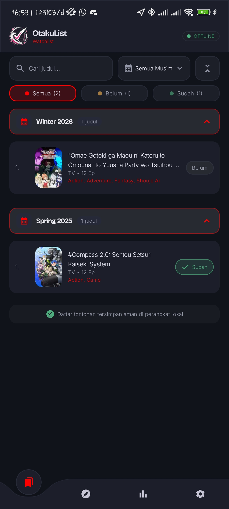
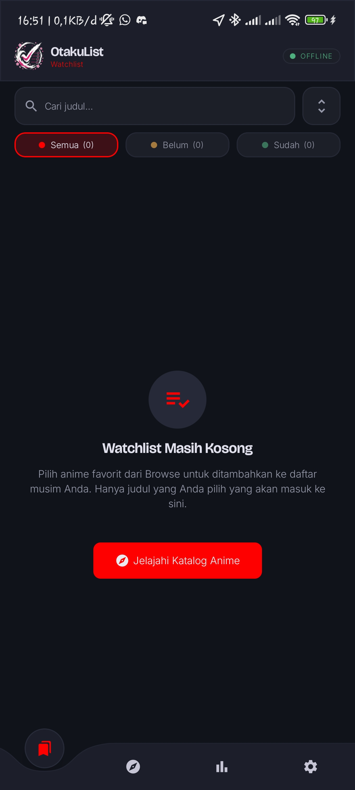
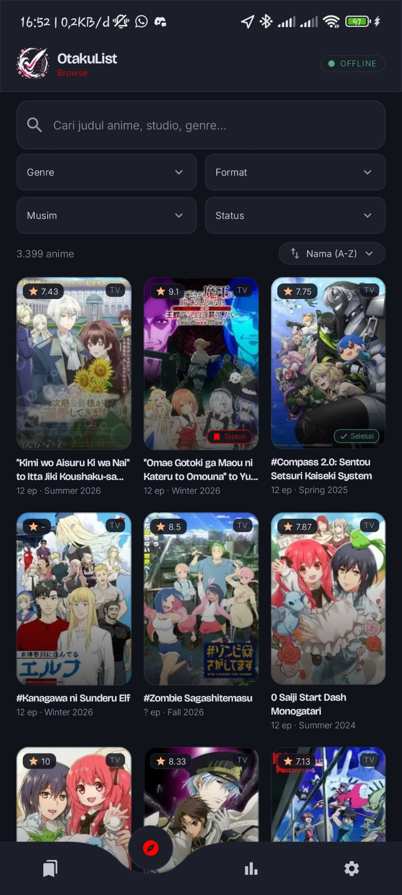
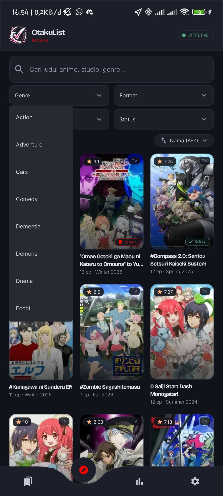
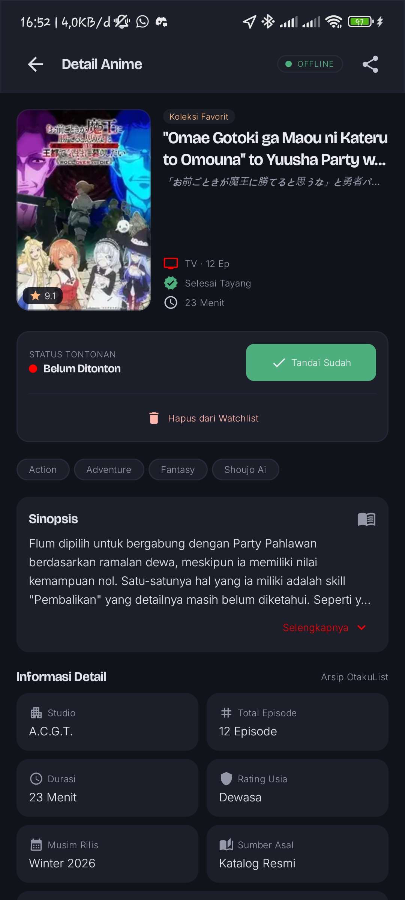
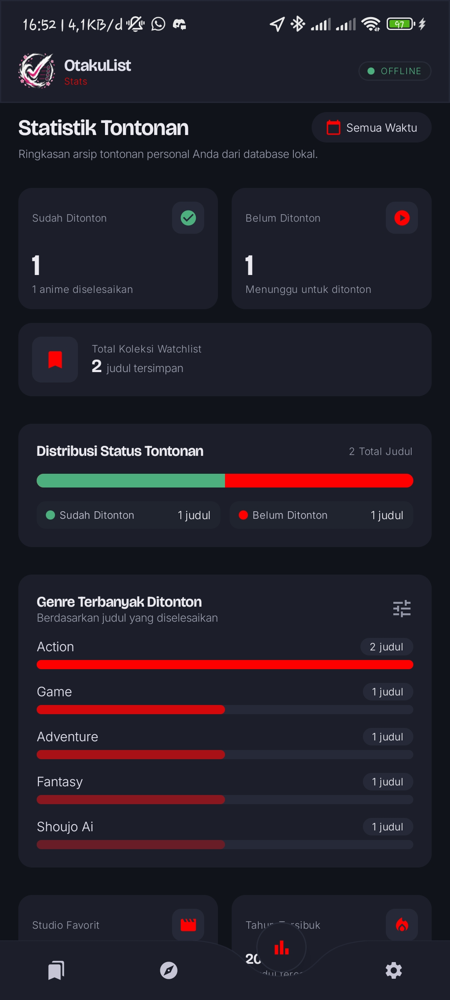
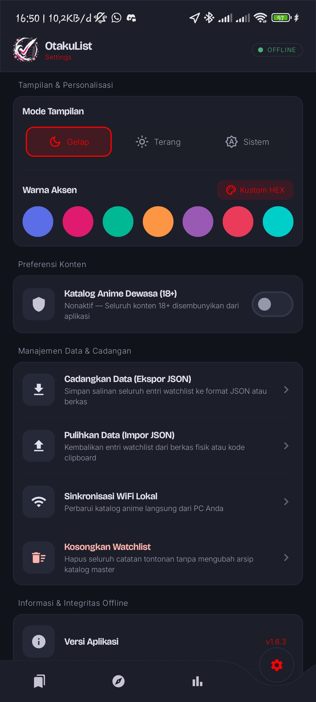

# OtakuList

Aplikasi katalog dan pencatat daftar tontonan (*watchlist*) anime berbasis Android (Jetpack Compose & Room Database) yang bekerja secara *offline-first*, dilengkapi dengan peralatan *scraper* dan server sinkronisasi delta melalui jaringan WiFi lokal.

## Tampilan Aplikasi

| Halaman Utama (Watchlist) | Halaman Utama (Kosong) | Eksplorasi Katalog | Filter Genre |
| :---: | :---: | :---: | :---: |
|  |  |  |  |

| Detail Anime | Statistik Tontonan | Pengaturan & Sinkronisasi |
| :---: | :---: | :---: |
|  |  |  |

## Struktur Repository

```text
OtakuList/
├── android/          # Aplikasi Android Native (Kotlin, Jetpack Compose, Room SQLite)
├── tools/            # Scraper Katalog (OtakOtaku & MyAnimeList) & Server Sinkronisasi WiFi
│   ├── scrapers/     # Modul ekstraktor katalog, karakter, kutipan, dan artikel
│   ├── sync/         # Delta scraper, generator paket patch, dan HTTP Sync Server (Port 8080)
│   ├── pipelines/    # Pipeline dump katalog penuh dan ekspor database Room
│   └── scripts/      # Batch runner utilitas pemeliharaan katalog
└── image/            # Tangkapan layar tampilan aplikasi
```

## Panduan Singkat

### 1. Aplikasi Android (`android/`)
1. Buka Android Studio dan pilih folder **`OtakuList/android`**.
2. Untuk melakukan kompilasi melalui terminal:
   ```powershell
   cd android
   .\gradlew.bat assembleDebug --parallel --build-cache
   ```

### 2. Alat Sinkronisasi Data (`tools/`)
1. Instal dependensi Python:
   ```powershell
   cd tools
   pip install -r requirements.txt
   ```
2. **Mengambil Pembaruan Katalog Baru (Delta Scraper)**:
   Jalankan `run_sync_delta.bat` (atau `python sync/sync_delta_scraper.py` diikuti `python sync/export_delta_patch.py`).
3. **Menjalankan Server Sinkronisasi WiFi Lokal**:
   Jalankan `run_sync_server.bat` (atau `python sync/sync_server.py`), lalu masukkan alamat IP yang tampil di terminal ke menu **Pengaturan > Sinkronisasi Katalog** di aplikasi Android.
